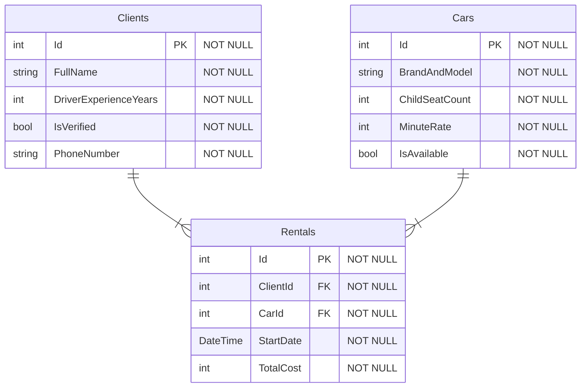

# Volvan
Сервис каршеринга автомобилей в Южно-Сахалинске

## Автор
Астраханцев Семён РПО-24/1

## Проект
- **Описание:**  Сервис каршеринга в Южно-Сахалинске с проверенными моделями автомобилей брендов Toyota и Hyundai. Сервис подходит так и для поездок по городу, так и для поездок по природе. Клиентам доступен выбор машин под любые задачи - от компактных седанов до вместительных кроссоверов. Клиенты могут забронировать нужный автомобиль за пару минут через приложение на Windows или Android. Каждый автомобиль проходит обязательную проверку технического состояния перед выездом на линию
- **Среди моделей**
    - Toyota Rav4
    - Toyota 4Runner
    - Toyota Camry
    - Toyota Vitz
    - Hyundai Palisade
    - Hyundai Tucson
    - Hyundai Elantra
    - Hyundai Solaris

## Схема базы данных

## Таблицы

### Clients
Данные о зарегистрированных пользователях сервиса

| Поле | Тип | Обязательное | Описание |
| :--- | :--- | :--- | :--- |
| Id | int | Да (PK) | Первичный ключ клиента |
| FullName | string | Да (NOT NULL) | Фамилия, имя и отчество клиента |
| DriverExperienceYears | int | Да (NOT NULL) | Стаж вождения клиента в годах |
| IsVerified | bool | Да (NOT NULL) | Проверены ли документы службой безопасности |
| PhoneNumber | string | Да (NOT NULL) | Контактный номер телефона клиента |

### Cars
Парк доступных автомобилей брендов Toyota и Hyundai

| Поле | Тип | Обязательное | Описание |
| :--- | :--- | :--- | :--- |
| Id | int | Да (PK) | Первичный ключ автомобиля |
| BrandAndModel | string | Да (NOT NULL) | Марка и модель автомобиля (например, Toyota, Hyundai) |
| ChildSeatCount | int | Да (NOT NULL) | Количество детских кресел, установленных в салоне |
| MinuteRate | int | Да (NOT NULL) | Стоимость одной минуты аренды в рублях |
| IsAvailable | bool | Да (NOT NULL) | Свободен ли автомобиль для бронирования в данный момент |

### Rentals
История и текущие факты аренды автомобилей клиентами

| Поле | Тип | Обязательное | Описание |
| :--- | :--- | :--- | :--- |
| Id | int | Да (PK) | Первичный ключ записи об аренде |
| ClientId | int | Да (FK) | Внешний ключ, ссылающийся на Id клиента |
| CarId | int | Да (FK) | Внешний ключ, ссылающийся на Id автомобиля |
| StartDate | DateTime | Да (NOT NULL) | Дата и точное время начала аренды |
| TotalCost | int | Да (NOT NULL) | Итоговая стоимость поездки в рублях |

## Связи
Между таблицами базы данных настроены следующие связи
- **Главные таблицы (`Clients` и `Cars`)**: Связаны между собой отношением «многие ко многим» через промежуточную связующую таблицу `Rentals`. Один клиент может арендовать много разных автомобилей в разное время, а один автомобиль может побывать в аренде у многих клиентов
- **Связующая таблица (`Rentals`)**: Содержит два обязательных внешних ключа (`ClientId` и `CarId`), которые ссылаются на первичные ключи главных таблиц, а также собственные поля (`StartDate` и `TotalCost`), описывающие конкретную поездку