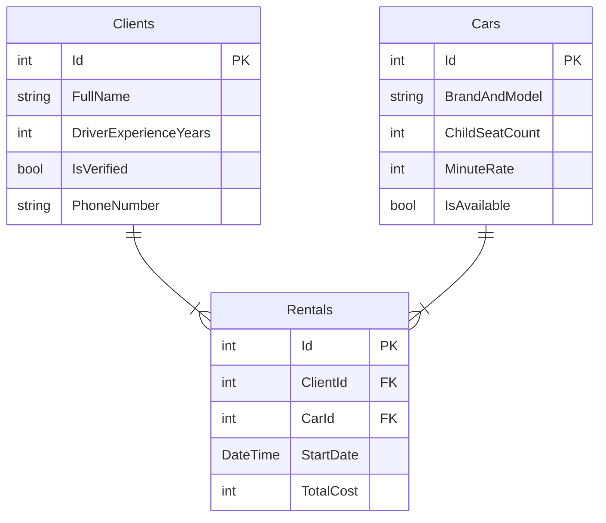

# Volvan
Сервис каршеринга автомобилей в Южно-Сахалинске

## Автор
... ...

## Проект
- **Описание:** Сервис каршеринга в Южно-Сахалинске с проверенными моделями автомобилей брендов Toyota и Hyundai. Наш сервис подходит так и для поездок по городу, так и для поездок по бездорожью и природе
- **Среди моделей**
- Toyota Rav4
- Toyota 4Runner
- Toyota Camry
- Toyota Vitz
- Hyundai Palisade
- Hyundai Tucson
- Hyundai Elantra
- Hyundai Solaris

## Схема базы данных

## Таблицы

### Clients
Данные о зарегистрированных пользователях сервиса

| Поле | Тип | Описание |
| :--- | :--- | :--- |
| Id | int | Первичный ключ клиента |
| FullName | string | Фамилия, имя и отчество клиента |
| DriverExperienceYears | int | Стаж вождения клиента в годах |
| IsVerified | bool | Проверены ли документы службой безопасности |
| PhoneNumber | string | Контактный номер телефона клиента |

### Cars
Парк доступных автомобилей брендов Toyota и Hyundai

| Поле | Тип | Описание |
| :--- | :--- | :--- |
| Id | int | Первичный ключ автомобиля |
| BrandAndModel | string | Марка и модель автомобиля (например, Toyota, Hyundai) |
| ChildSeatCount | int | Количество детских кресел, установленных в салоне |
| MinuteRate | int | Стоимость одной минуты аренды в рублях |
| IsAvailable | bool | Свободен ли автомобиль для бронирования в данный момент |

### Rentals
История и текущие факты аренды автомобилей клиентами

| Поле | Тип | Описание |
| :--- | :--- | :--- |
| Id | int | Первичный ключ записи об аренде |
| ClientId | int | Внешний ключ, ссылающийся на Id клиента |
| CarId | int | Внешний ключ, ссылающийся на Id автомобиля |
| StartDate | DateTime | Дата и точное время начала аренды |
| TotalCost | int | Итоговая стоимость поездки в рублях |

## Связи
Между таблицами базы данных настроены следующие связи
- **Главные таблицы (`Clients` и `Cars`)**: Связаны между собой отношением «многие ко многим» через промежуточную связующую таблицу `Rentals`. Один клиент может арендовать много разных автомобилей в разное время, а один автомобиль может побывать в аренде у многих клиентов
- **Связующая таблица (`Rentals`)**: Содержит два обязательных внешних ключа (`ClientId` и `CarId`), которые ссылаются на первичные ключи главных таблиц, а также собственные поля (`StartDate` и `TotalCost`), описывающие конкретную поездку